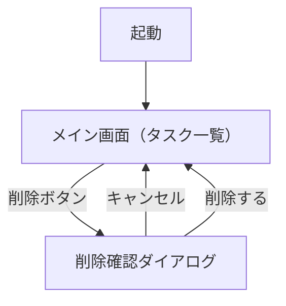

# UI/UX思想

## 原則

### 1画面で完結させる

- 内容: タスクの追加・確認・完了・削除を1画面で行い、ページ遷移を挟まない
- 由来: P3 の回答「1画面で完結」（2026-11-13）
- 適用例: メイン画面上部に追加フォーム、下にタスク一覧を配置

### 破壊的操作は確認する

- 内容: 削除は即実行せず、対象タスク名を示した確認ダイアログを挟む
- 由来: 【承認B】の画面構成（2026-11-13）
- 適用例: 削除ボタン → 削除確認ダイアログ → 「削除する」で確定

### 今やることに集中できる分け方

- 内容: 未完了タスクを先に表示し、完了済みは下のセクションにまとめる
- 由来: 【承認B】の画面構成（2026-11-13）
- 適用例: 未完了一覧の下に「完了済み」セクションを表示

### 情報は詰め込まない

- 内容: タスク1件につき表示する情報は、タイトル・期限・優先度・操作に絞る
- 由来: `intent.md` の「必要最小限の機能」「シンプルで迷わない操作感」（2026-11-13）
- 適用例: 期限と優先度はバッジ形式でコンパクトに表示

### 温かみのあるカードUI

- 内容: 生成り色の背景、丸みのあるカード、オレンジ系のアクセントで、肩の力を抜いて使える見た目にする
- 由来: P4 の回答「ウォーム＆カード」（2026-11-13）
- 適用例: 追加フォームとタスク一覧をカードで区切り、タスク1件ずつをやわらかいカードとして表示

### 状態が一目で分かる

- 内容: 読み込み中・読み込みエラー・0件・操作エラーを、それぞれ専用の表示で伝える。読み込み中はレイアウトの高さを保ち、表示の切り替わりで画面が跳ねないようにする
- 由来: 【承認C】のUI（2026-11-13）
- 適用例: 読み込み中はスケルトン、読み込みエラーは再読み込みボタン、0件は「タスクはまだありません」、操作エラーは一覧上部の閉じられる帯で表示

### 操作中は二重操作を防ぐ

- 内容: 追加・完了の切替・削除の実行中は、同じ操作を無効化して結果を待たせる
- 由来: 【承認C】のUI（2026-11-13）
- 適用例: 追加中は「追加中...」、削除中は「削除中...」と表示し、対象のボタンとチェックボックスを無効化

### キーボードだけで迷わず操作できる

- 内容: 主要な操作をキーボードだけで完結でき、操作後にフォーカスが行方不明にならない
- 由来: 【承認C】のUI（2026-11-13）
- 適用例: 追加成功後はタイトル欄、完了切替後は同じチェックボックス、削除後は一覧見出しへフォーカスを移す。削除ダイアログはフォーカスを閉じ込め、Escapeで閉じる

### 狭い幅でも崩れない

- 内容: PC中心の利用を想定しつつ、狭いウィンドウでも入力・一覧・ダイアログが破綻しない
- 由来: 【承認C】のUI（2026-11-13）
- 適用例: 480px幅ではフォームと期限・優先度を縦に積み、ダイアログは画面幅に収める

## 画面構成（確定）

| 画面                     | 目的                                                 | 主な表示情報                                                           | 主な操作                            |
| ------------------------ | ---------------------------------------------------- | ---------------------------------------------------------------------- | ----------------------------------- |
| メイン画面（タスク一覧） | タスクを追加し、期限・優先度を見ながら完了・削除する | 追加フォーム、残り件数、未完了タスク、完了済みタスク、空状態メッセージ | タスク追加、完了/未完了の切替、削除 |
| 削除確認ダイアログ       | 削除の誤操作を防ぐ                                   | 削除対象のタスク名、取り消せない旨の注意                               | 削除する、キャンセル                |

### 今回のスコープ外

- ログイン・認証
- 検索・絞り込み
- タスクの編集
- 複数画面・設定画面
- 複数端末での同期

## 不採用案とその理由

- 画面構成: 1画面完結を選んだ。追加モーダル・追加別画面は、クリック数が増え、今回の規模では過剰なため見送った。
- 削除: 確認ダイアログを選んだ。即時削除は誤操作時に取り消せないため見送った。
- デザイン: ウォーム＆カードを選んだ。クリーン＆ミニマルは無機質に感じられ、ダーク＆フォーカスは個人用の気軽なToDoには重いため見送った。
- 優先度: 高・中・低の3段階を選んだ。2段階は「中」を表せず、5段階は選択の負担が大きいため見送った。
- 期限: 日付のみを選んだ。日付＋時刻は入力項目が増え、今回の用途には細かすぎるため見送った。
